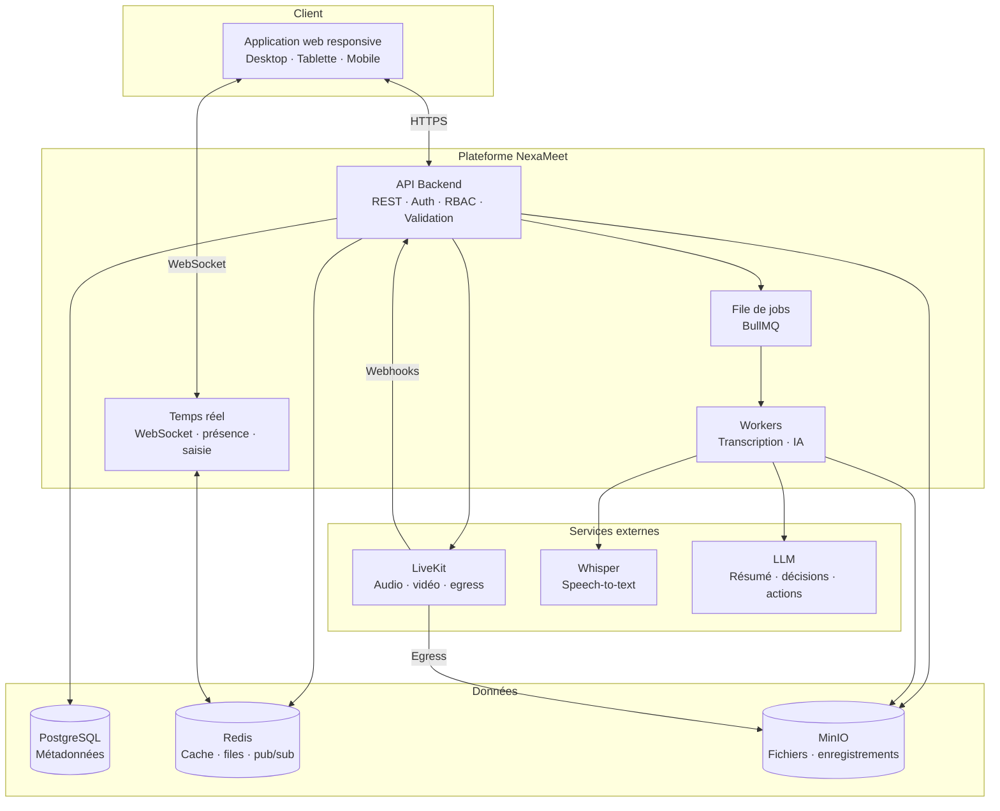

# NexaMeet

> **Connect. Collaborate. Understand. Act.**

**NexaMeet** est une plateforme universitaire de collaboration et de réunions intelligentes.
Elle réunit dans un même espace les équipes, les projets, les tâches, la messagerie, les fichiers
et les réunions vidéo — puis transforme automatiquement le contenu des réunions en **comptes rendus,
décisions et tâches actionnables** grâce à l'IA.


---

## 🌐 Documentation en ligne

Toute la documentation est disponible sous forme de site web navigable :

### **https://mohameden19961.github.io/nexameet/**

Le site permet de :

- parcourir les **22 sections** et les documents d'architecture ;
- rechercher du texte dans l'ensemble de la documentation ;
- afficher les diagrammes **Mermaid** (architecture, flux, modèle de données) ;
- naviguer au clavier, en mode clair ou sombre, sur mobile comme sur desktop.

En local, il suffit d'ouvrir [`index.html`](index.html) dans un navigateur.
Le contenu est embarqué dans `content.js`, donc aucun serveur n'est nécessaire.

> Après une modification des fichiers Markdown, régénérer le contenu du site avec
> `node tools/build-content.js`.

---

## Sommaire

- [Pourquoi NexaMeet ?](#pourquoi-nexameet-)
- [Concept central](#concept-central)
- [Public cible](#public-cible)
- [Les quatre piliers](#les-quatre-piliers)
- [Parcours de bout en bout](#parcours-de-bout-en-bout)
- [Architecture en un coup d'œil](#architecture-en-un-coup-dœil)
- [Stack technique](#stack-technique)
- [Périmètre du MVP](#périmètre-du-mvp)
- [Documentation](#documentation)
- [Structure du dépôt](#structure-du-dépôt)
- [Comment lire ce dépôt](#comment-lire-ce-dépôt)
- [Feuille de route](#feuille-de-route)
- [Contribution](#contribution)
- [Licence](#licence)

---

## Pourquoi NexaMeet ?

Dans le milieu universitaire, le travail d'équipe est dispersé entre messageries, drives,
outils de gestion de projet et visioconférences. Les décisions prises en réunion se perdent,
les actions décidées ne sont pas suivies, et les comptes rendus sont rarement rédigés.

NexaMeet répond à ce problème avec une promesse simple :

> **Une réunion ne doit pas seulement se dérouler. Elle doit produire un résultat exploitable.**

La plateforme relie le **travail collaboratif** (équipes, projets, tâches, canaux) au
**moment de décision** (la réunion), puis à l'**exécution** (tâches créées, assignées et suivies).

## Concept central

| Élément | Description |
|---|---|
| **Produit** | NexaMeet |
| **Catégorie** | Plateforme universitaire de collaboration et de réunions intelligentes |
| **Concept** | Connect. Collaborate. Understand. Act. |
| **Promesse** | Relier les personnes, structurer le travail, comprendre les échanges, passer à l'action |

Le cycle produit suit quatre étapes :

1. **Connect** — comptes, espaces de travail, invitations, rôles et permissions.
2. **Collaborate** — équipes, projets, canaux, messages, fichiers et réunions.
3. **Understand** — transcription, résumé, extraction des décisions et des actions par l'IA.
4. **Act** — revue humaine, approbation, création de tâches et suivi dans le Kanban.

## Public cible

- **Universités et établissements d'enseignement supérieur**
- **Enseignants et responsables pédagogiques**
- **Étudiants et équipes de projets de fin d'études**
- **Équipes de recherche**
- **Administrateurs et propriétaires d'espaces de travail**

## Les quatre piliers

### 1. Collaboration structurée
Espaces de travail, équipes, projets, canaux publics ou privés, messages directs,
fichiers partagés et gestion fine des rôles (Owner, Administrator, Teacher, Student, Member).

### 2. Réunions vidéo intégrées
Création, planification et tenue de réunions avec **LiveKit** : audio, vidéo, partage d'écran,
salle d'attente, contrôles de l'hôte, enregistrement et historique.

### 3. Assistant IA de réunion
Traitement asynchrone des enregistrements : **Whisper** pour la transcription, puis un **LLM**
pour le résumé, les décisions et les tâches suggérées. Tous les résultats passent par une
**revue humaine** avant d'être intégrés au projet.

### 4. Gouvernance et confiance
RBAC vérifié côté backend, isolation entre espaces de travail, audit logs, politiques de
rétention, consentement à l'enregistrement, rate limiting et protection des secrets.

## Parcours de bout en bout

Le MVP est considéré comme réussi uniquement si ce scénario fonctionne de manière fiable :

```text
Inscription
  → Création d'un espace de travail
  → Invitation des membres
  → Création d'un projet
  → Création d'un canal lié au projet
  → Échanges en temps réel
  → Création et assignation d'une tâche
  → Création d'une réunion liée au projet
  → Participation avec caméra, micro et partage d'écran
  → Enregistrement de la réunion
  → Sauvegarde dans MinIO
  → Webhook de fin d'enregistrement
  → Traitement par un worker
  → Transcription Whisper
  → Résumé, décisions et tâches proposées par le LLM
  → Revue humaine
  → Approbation des tâches
  → Apparition dans le Kanban
  → Suivi de l'exécution
```

La version détaillée se trouve dans [`docs/22-definition-of-done.md`](docs/22-definition-of-done.md)
et la narration complète dans [`docs/parcours-utilisateur.md`](docs/parcours-utilisateur.md).

## Architecture en un coup d'œil



Détails, flux et responsabilités : [`architecture/README.md`](architecture/README.md).

## Stack technique

| Couche | Technologie | Statut |
|---|---|---|
| Base de données | **PostgreSQL** | Spécifié |
| Cache, files et temps réel | **Redis** | Spécifié |
| File de traitement | **BullMQ** | Spécifié |
| Stockage objet | **MinIO** | Spécifié |
| Visioconférence | **LiveKit** | Spécifié |
| Transcription | **Whisper** | Spécifié |
| Résumé / décisions / actions | **LLM** (modèle non imposé) | Spécifié |
| Conteneurisation | **Docker Compose** | Spécifié |
| Frontend | Application web responsive | Non imposé — proposition dans la doc |
| Backend | API REST + WebSocket | Non imposé — proposition dans la doc |

> Le catalogue fonctionnel fixe les **capacités** et certains composants d'infrastructure.
> Les choix non spécifiés sont présentés comme des **propositions** dans
> [`architecture/stack-technique.md`](architecture/stack-technique.md).

## Périmètre du MVP

Le MVP couvre sept blocs :

| Bloc | Contenu |
|---|---|
| **A. Identité & espace de travail** | Inscription, connexion, réinitialisation, vérification e-mail, profil, workspace, membres, invitations, RBAC de base |
| **B. Collaboration** | Équipes, projets, canaux, messages directs, messagerie temps réel, notifications de base |
| **C. Gestion de projet** | Projets, membres, tâches, assignation, statuts, Kanban, commentaires |
| **D. Fichiers** | Upload, téléchargement, suppression, organisation de base, permissions |
| **E. Réunions** | Création, participation, LiveKit, audio/vidéo, partage d'écran, gestion des participants, enregistrement, historique |
| **F. Assistant IA** | Traitement, Whisper, transcript, résumé, décisions, actions, revue humaine, création de tâches approuvées |
| **G. Système** | Redis, BullMQ, workers, MinIO, PostgreSQL, Docker Compose, monitoring de base, tests unitaires et d'intégration |

Voir [`docs/20-mvp.md`](docs/20-mvp.md) pour la liste complète et
[`docs/21-hors-mvp.md`](docs/21-hors-mvp.md) pour ce qui est volontairement exclu.

## Documentation

Les 22 sections du catalogue fonctionnel sont documentées une par une.

### Fondations

| # | Section | Fichier |
|---|---|---|
| 1 | Authentification & gestion d'identité | [`docs/01-authentification.md`](docs/01-authentification.md) |
| 2 | Gestion des espaces de travail | [`docs/02-workspaces.md`](docs/02-workspaces.md) |
| 3 | Rôles & permissions (RBAC) | [`docs/03-roles-permissions.md`](docs/03-roles-permissions.md) |
| 4 | Gestion des équipes | [`docs/04-equipes.md`](docs/04-equipes.md) |

### Collaboration & travail

| # | Section | Fichier |
|---|---|---|
| 5 | Gestion de projets | [`docs/05-projets.md`](docs/05-projets.md) |
| 6 | Gestion des tâches — Kanban | [`docs/06-taches-kanban.md`](docs/06-taches-kanban.md) |
| 7 | Messagerie en temps réel | [`docs/07-messagerie.md`](docs/07-messagerie.md) |
| 8 | Gestion des fichiers | [`docs/08-fichiers.md`](docs/08-fichiers.md) |

### Réunions & intelligence

| # | Section | Fichier |
|---|---|---|
| 9 | Gestion des réunions | [`docs/09-reunions.md`](docs/09-reunions.md) |
| 10 | Intégration LiveKit | [`docs/10-livekit.md`](docs/10-livekit.md) |
| 11 | Assistant IA de réunion | [`docs/11-assistant-ia.md`](docs/11-assistant-ia.md) |

### Plateforme

| # | Section | Fichier |
|---|---|---|
| 12 | Système de notifications | [`docs/12-notifications.md`](docs/12-notifications.md) |
| 13 | Système de recherche | [`docs/13-recherche.md`](docs/13-recherche.md) |
| 14 | Tableau de bord & activité | [`docs/14-tableau-de-bord.md`](docs/14-tableau-de-bord.md) |
| 15 | Administration & gouvernance | [`docs/15-administration.md`](docs/15-administration.md) |

### Transverse

| # | Section | Fichier |
|---|---|---|
| 16 | Sécurité & confidentialité | [`docs/16-securite.md`](docs/16-securite.md) |
| 17 | Système & traitement en arrière-plan | [`docs/17-taches-de-fond.md`](docs/17-taches-de-fond.md) |
| 18 | Expérience utilisateur & interface | [`docs/18-experience-utilisateur.md`](docs/18-experience-utilisateur.md) |

### Cadrage produit

| # | Section | Fichier |
|---|---|---|
| 19 | Fonctionnalités avancées & futures | [`docs/19-fonctionnalites-avancees.md`](docs/19-fonctionnalites-avancees.md) |
| 20 | MVP — première version officielle | [`docs/20-mvp.md`](docs/20-mvp.md) |
| 21 | Hors périmètre du MVP | [`docs/21-hors-mvp.md`](docs/21-hors-mvp.md) |
| 22 | Definition of Done du MVP | [`docs/22-definition-of-done.md`](docs/22-definition-of-done.md) |

### Documents complémentaires

| Document | Description |
|---|---|
| [`docs/README.md`](docs/README.md) | Index détaillé de la documentation |
| [`docs/glossaire.md`](docs/glossaire.md) | Termes métier et techniques |
| [`docs/parcours-utilisateur.md`](docs/parcours-utilisateur.md) | Scénario complet, étape par étape |
| [`architecture/README.md`](architecture/README.md) | Architecture, composants et flux |
| [`architecture/stack-technique.md`](architecture/stack-technique.md) | Stack spécifiée et propositions |
| [`architecture/modele-de-donnees.md`](architecture/modele-de-donnees.md) | Entités et relations proposées |

## Structure du dépôt

```text
nexameet/
├── README.md
├── index.html                    # Site de documentation (GitHub Pages)
├── content.js                    # Contenu Markdown embarqué (généré)
├── .nojekyll                     # Désactive Jekyll sur GitHub Pages
├── .gitignore
├── tools/
│   └── build-content.js          # Régénère content.js depuis les .md
├── docs/
│   ├── README.md                 # Index de la documentation
│   ├── 01-authentification.md
│   ├── 02-workspaces.md
│   ├── 03-roles-permissions.md
│   ├── 04-equipes.md
│   ├── 05-projets.md
│   ├── 06-taches-kanban.md
│   ├── 07-messagerie.md
│   ├── 08-fichiers.md
│   ├── 09-reunions.md
│   ├── 10-livekit.md
│   ├── 11-assistant-ia.md
│   ├── 12-notifications.md
│   ├── 13-recherche.md
│   ├── 14-tableau-de-bord.md
│   ├── 15-administration.md
│   ├── 16-securite.md
│   ├── 17-taches-de-fond.md
│   ├── 18-experience-utilisateur.md
│   ├── 19-fonctionnalites-avancees.md
│   ├── 20-mvp.md
│   ├── 21-hors-mvp.md
│   ├── 22-definition-of-done.md
│   ├── glossaire.md
│   └── parcours-utilisateur.md
├── architecture/
│   ├── README.md
│   ├── stack-technique.md
│   └── modele-de-donnees.md
└── assets/
    ├── NexaMeet.svg              # Diagramme source exporté
    └── NexaMeet.drawio           # Version éditable (draw.io)
```

## Comment lire ce dépôt

Ce dépôt est un **dépôt de spécification fonctionnelle et d'architecture cible**.
Il ne contient pas encore de code applicatif : il sert de référence commune pour concevoir,
développer, tester et présenter NexaMeet.

La version web est disponible sur **https://mohameden19961.github.io/nexameet/**.
Le fichier [`index.html`](index.html) peut aussi être ouvert directement en local.

Trois parcours de lecture sont possibles :

1. **Découvrir le produit** — lire ce README, puis
   [`docs/parcours-utilisateur.md`](docs/parcours-utilisateur.md).
2. **Comprendre le périmètre** — lire [`docs/20-mvp.md`](docs/20-mvp.md),
   [`docs/21-hors-mvp.md`](docs/21-hors-mvp.md) et
   [`docs/22-definition-of-done.md`](docs/22-definition-of-done.md).
3. **Préparer l'implémentation** — lire [`architecture/README.md`](architecture/README.md),
   [`architecture/stack-technique.md`](architecture/stack-technique.md) et
   [`architecture/modele-de-donnees.md`](architecture/modele-de-donnees.md),
   puis les 22 sections fonctionnelles.

> **Convention de lecture** : chaque section indique son statut —
> `MVP`, `Post-MVP` ou `Transverse` — et renvoie aux sections liées.

## Feuille de route

| Phase | Objectif | Contenu principal |
|---|---|---|
| **0. Cadrage** | Aligner tout le monde | Catalogue fonctionnel, architecture, modèle de données, Definition of Done |
| **1. Fondations** | Comptes et espaces | Auth, profils, workspaces, invitations, RBAC, équipes |
| **2. Collaboration** | Travailler ensemble | Projets, tâches, Kanban, canaux, messages, fichiers, notifications |
| **3. Réunions** | Se retrouver | LiveKit, tokens, contrôles hôte, enregistrement, historique |
| **4. Intelligence** | Comprendre et agir | Whisper, résumé, décisions, actions, revue humaine, création de tâches |
| **5. Durcissement** | Fiabiliser | Sécurité, audit, monitoring, tests, Docker Compose |
| **6. Post-MVP** | Étendre | Whiteboard, calendrier avancé, webinaires, analytics, mobile, IA avancée |

## Contribution

Les contributions sont bienvenues. Avant de proposer une modification :

1. Vérifier que le changement respecte le périmètre du MVP
   ([`docs/20-mvp.md`](docs/20-mvp.md)) et la Definition of Done
   ([`docs/22-definition-of-done.md`](docs/22-definition-of-done.md)).
2. Mettre à jour la section fonctionnelle concernée dans `docs/`.
3. Mettre à jour l'architecture ou le modèle de données si le changement l'exige.
4. Garder la documentation en français et les identifiants techniques en anglais.
5. Ouvrir une pull request avec une description claire du besoin et de l'impact.

## Licence

La licence de ce projet reste **à définir**. En l'absence de fichier `LICENSE`,
le contenu est protégé par le droit d'auteur par défaut.

---

<p align="center">
  <strong>NexaMeet</strong> — Connect. Collaborate. Understand. Act.
</p>
