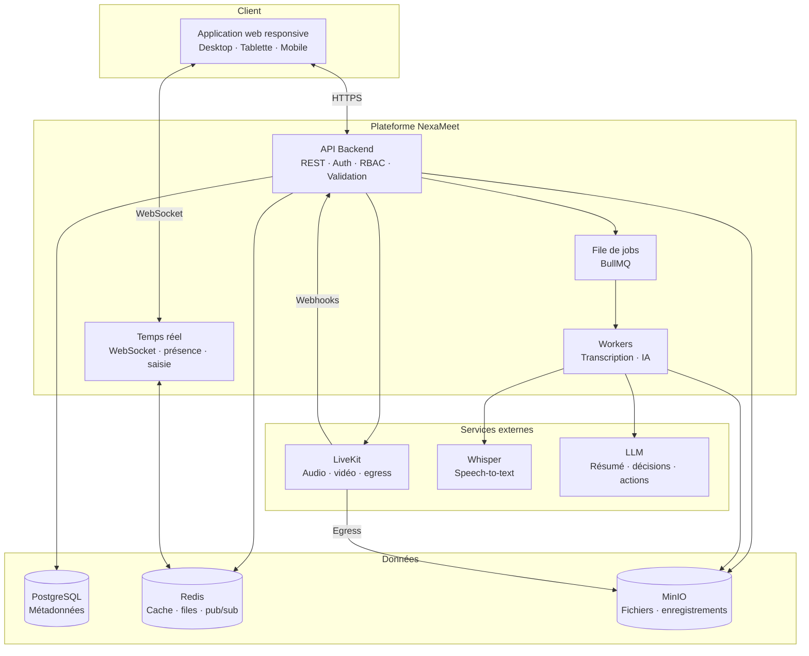
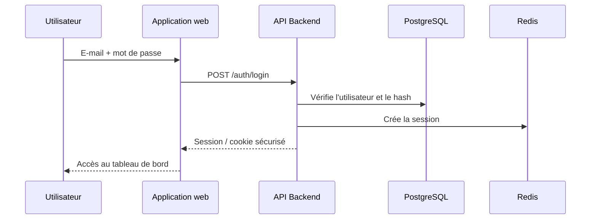
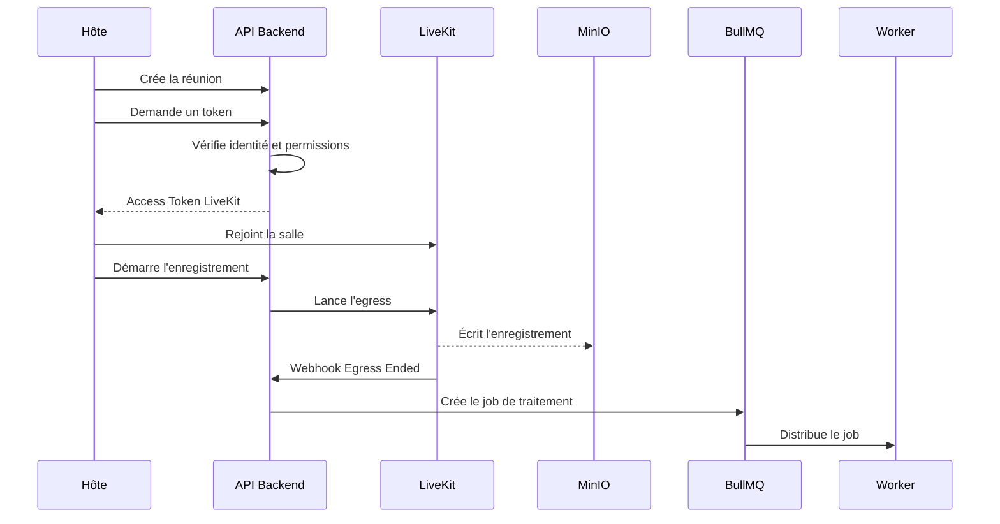
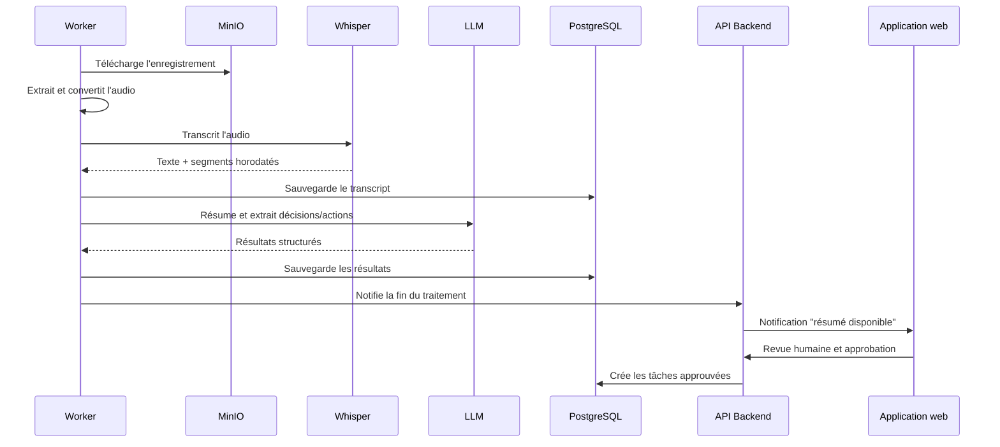
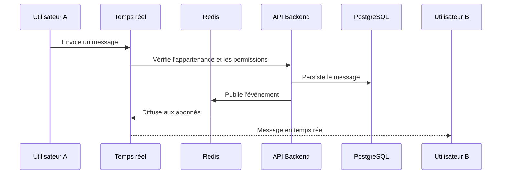

# Architecture NexaMeet

> **Nature du document :** architecture cible proposée, dérivée du catalogue fonctionnel.
> Les composants explicitement nommés dans le catalogue sont **spécifiés** ; les autres
> choix sont des **propositions** clairement identifiées.

## Vue d'ensemble

NexaMeet est une application web multi-espaces (*multi-tenant*) composée de :

- une **application web responsive** ;
- une **API backend** centralisant l'authentification, les permissions et la logique métier ;
- un **canal temps réel** pour la messagerie, la présence et les notifications ;
- des **workers asynchrones** pour la transcription et l'IA ;
- des **services d'infrastructure** : PostgreSQL, Redis, MinIO et LiveKit ;
- des **services externes** : Whisper et un LLM.



## Composants et responsabilités

### Application web

- Interface responsive (desktop, tablette, mobile).
- Navigation latérale, changement d'espace de travail.
- Modules : projets, Kanban, messagerie, fichiers, réunions, assistant IA, administration.
- Support du mode clair/sombre, du français et de l'arabe (RTL).
- Aucune décision de sécurité : elle consomme les permissions fournies par l'API.

### API backend

- Point d'entrée unique pour les opérations métier.
- Authentification, gestion des sessions, vérification RBAC.
- Validation des entrées et isolation des espaces.
- Génération des URLs présignées et des tokens LiveKit.
- Réception des webhooks LiveKit (signature vérifiée).
- Création des jobs BullMQ.
- Émission des notifications.

### Service temps réel

- Connexions WebSocket authentifiées.
- Diffusion des messages, de la présence et des indicateurs de saisie.
- Synchronisation à la reconnexion.
- Publication/abonnement via Redis pour le passage à l'échelle.
- Peut être intégré au backend dans une première version, puis extrait.

### Workers

- Consommation des jobs BullMQ.
- Téléchargement des enregistrements depuis MinIO.
- Extraction et conversion audio.
- Appels à Whisper et au LLM.
- Persistance des transcripts, résumés, décisions et actions.
- Nettoyage des fichiers temporaires.
- Idempotence et reprise sur échec.

### PostgreSQL

- Source de vérité des métadonnées : utilisateurs, espaces, rôles, projets, tâches,
  messages, fichiers, réunions, transcripts, résultats IA, notifications, audit logs.
- Contraintes d'intégrité et migrations versionnées.

### Redis

- Cache et données éphémères.
- Backend des files BullMQ.
- Présence et pub/sub pour le temps réel.
- Rate limiting distribué le cas échéant.

### MinIO

- Stockage objet des fichiers et des enregistrements.
- Buckets séparés ou préfixes par type de contenu.
- Accès via URLs présignées à durée limitée.
- Politiques de rétention et de cycle de vie.

### LiveKit

- Salles audio/vidéo et partage d'écran.
- Tokens d'accès signés côté serveur.
- Egress pour l'enregistrement.
- Webhooks vers le backend.

### Whisper et LLM

- Whisper : transcription avec segments horodatés.
- LLM : résumé, décisions, actions, avec sorties structurées.
- Appelés uniquement par les workers, jamais directement par le client.

## Flux principaux

### 1. Authentification



### 2. Réunion et enregistrement



### 3. Pipeline IA



### 4. Messagerie temps réel



## Sécurité de l'architecture

- Toutes les communications client → plateforme en **HTTPS/WSS**.
- Les secrets (clé LiveKit, accès MinIO, clés LLM) restent côté serveur.
- Les webhooks sont signés et vérifiés.
- Les URLs de fichiers sont présignées et temporaires.
- Les workers n'exposent aucun endpoint public.
- L'isolation des espaces est vérifiée à chaque requête.
- Les journaux ne contiennent ni secrets ni tokens.

## Déploiement

Le catalogue impose **Docker Compose** pour l'environnement de développement et de
démonstration. Une topologie cible :

```text
docker-compose
├── web            (frontend)
├── api            (backend)
├── worker         (BullMQ consumers)
├── postgres
├── redis
├── minio
└── livekit
```

Les services Whisper et LLM peuvent être :

- des services conteneurisés locaux ;
- des API externes configurées par variables d'environnement.

## Limites et décisions ouvertes

| Sujet | État |
|---|---|
| Framework frontend | Non spécifié — proposition à valider |
| Framework backend | Non spécifié — proposition à valider |
| Mécanisme de session | Non spécifié — cookies sécurisés ou JWT à décider |
| Bibliothèque temps réel | Non spécifiée — WebSocket natif ou Socket.IO |
| Modèle LLM | Non spécifié — à choisir selon coût, langue et confidentialité |
| Recherche | Non spécifiée — PostgreSQL full-text au départ, moteur dédié ensuite |
| Multi-tenant | Isolation logique par espace de travail, pas multi-base |

## Liens

- [Stack technique](stack-technique.md)
- [Modèle de données](modele-de-donnees.md)
- [Sécurité](../docs/16-securite.md)
- [Tâches de fond](../docs/17-taches-de-fond.md)
- [LiveKit](../docs/10-livekit.md)
