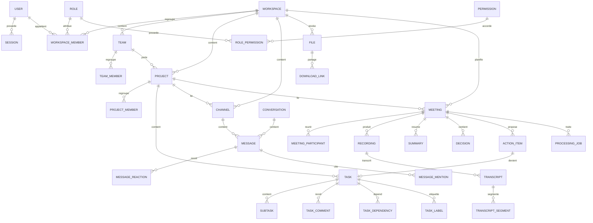

# Modèle de données

> **Nature du document :** modèle **proposé**, dérivé des fonctionnalités du catalogue.
> Il ne fait pas partie de la spécification imposée. Les noms sont en anglais pour rester
> compatibles avec le code et la base de données.

## Principes

- Toute ressource métier appartient à un **espace de travail** (`workspace_id`), sauf les
  utilisateurs et les référentiels globaux.
- Les permissions sont vérifiées à partir de l'appartenance à l'espace et du rôle.
- Les entités utilisent des identifiants opaques (UUID) plutôt que des identifiants séquentiels.
- Les suppressions sont logiques lorsque la restauration ou l'audit l'exigent
  (`deleted_at`).
- Les dates sont stockées en UTC ; l'affichage respecte le fuseau de l'utilisateur.
- Les fichiers ne sont pas stockés en base : seule la clé de stockage MinIO l'est.

## Entités principales

### Identité

| Entité | Champs clés |
|---|---|
| `users` | `id`, `email`, `password_hash`, `full_name`, `avatar_url`, `bio`, `language`, `timezone`, `email_verified_at`, `status`, `created_at` |
| `sessions` | `id`, `user_id`, `token_hash`, `device`, `ip`, `expires_at`, `revoked_at` |
| `password_reset_tokens` | `id`, `user_id`, `token_hash`, `expires_at`, `used_at` |

### Espaces et rôles

| Entité | Champs clés |
|---|---|
| `workspaces` | `id`, `name`, `description`, `logo_url`, `type`, `owner_id`, `privacy`, `created_at` |
| `workspace_members` | `id`, `workspace_id`, `user_id`, `role_id`, `status`, `joined_at` |
| `invitations` | `id`, `workspace_id`, `email`, `role_id`, `token_hash`, `status`, `expires_at` |
| `roles` | `id`, `workspace_id`, `name`, `is_default` |
| `permissions` | `id`, `key`, `description` |
| `role_permissions` | `role_id`, `permission_id` |

### Équipes

| Entité | Champs clés |
|---|---|
| `teams` | `id`, `workspace_id`, `name`, `description`, `image_url`, `lead_id` |
| `team_members` | `id`, `team_id`, `user_id`, `role` |

### Projets et tâches

| Entité | Champs clés |
|---|---|
| `projects` | `id`, `workspace_id`, `team_id`, `name`, `description`, `start_date`, `end_date`, `status`, `priority`, `manager_id`, `archived_at` |
| `project_members` | `id`, `project_id`, `user_id` |
| `tasks` | `id`, `project_id`, `title`, `description`, `assignee_id`, `status`, `priority`, `due_date`, `source_meeting_id`, `created_by`, `created_at` |
| `subtasks` | `id`, `task_id`, `title`, `is_done`, `position` |
| `labels` | `id`, `workspace_id`, `name`, `color` |
| `task_labels` | `task_id`, `label_id` |
| `task_dependencies` | `id`, `task_id`, `depends_on_task_id` |
| `task_comments` | `id`, `task_id`, `author_id`, `content`, `created_at` |
| `task_history` | `id`, `task_id`, `actor_id`, `field`, `old_value`, `new_value`, `created_at` |

### Messagerie

| Entité | Champs clés |
|---|---|
| `channels` | `id`, `workspace_id`, `project_id`, `name`, `description`, `type`, `archived_at` |
| `channel_members` | `channel_id`, `user_id` |
| `conversations` | `id`, `workspace_id`, `type` |
| `conversation_members` | `conversation_id`, `user_id` |
| `messages` | `id`, `channel_id`, `conversation_id`, `sender_id`, `parent_id`, `content`, `edited_at`, `deleted_at`, `created_at` |
| `message_reactions` | `id`, `message_id`, `user_id`, `emoji` |
| `message_mentions` | `message_id`, `user_id` |
| `message_reads` | `message_id`, `user_id`, `read_at` |

### Fichiers

| Entité | Champs clés |
|---|---|
| `folders` | `id`, `workspace_id`, `project_id`, `parent_id`, `name` |
| `files` | `id`, `workspace_id`, `project_id`, `meeting_id`, `message_id`, `folder_id`, `owner_id`, `name`, `mime_type`, `size`, `storage_key`, `checksum`, `deleted_at`, `created_at` |
| `file_permissions` | `id`, `file_id`, `subject_type`, `subject_id`, `can_view`, `can_download`, `can_delete` |
| `download_links` | `id`, `file_id`, `token_hash`, `expires_at`, `used_at` |

### Réunions et médias

| Entité | Champs clés |
|---|---|
| `meetings` | `id`, `workspace_id`, `project_id`, `channel_id`, `title`, `description`, `starts_at`, `duration_minutes`, `host_id`, `status`, `join_code` |
| `meeting_participants` | `id`, `meeting_id`, `user_id`, `role`, `status`, `joined_at`, `left_at` |
| `recordings` | `id`, `meeting_id`, `storage_key`, `status`, `duration_seconds`, `size`, `created_at` |
| `transcripts` | `id`, `meeting_id`, `recording_id`, `language`, `status`, `version`, `original_text`, `created_at` |
| `transcript_segments` | `id`, `transcript_id`, `start_ms`, `end_ms`, `text`, `speaker_label` |
| `summaries` | `id`, `meeting_id`, `transcript_id`, `language`, `content`, `version`, `created_at` |
| `decisions` | `id`, `meeting_id`, `transcript_segment_id`, `description`, `status`, `created_at` |
| `action_items` | `id`, `meeting_id`, `transcript_segment_id`, `title`, `description`, `suggested_assignee_id`, `suggested_due_date`, `confidence`, `status`, `task_id` |
| `processing_jobs` | `id`, `meeting_id`, `type`, `status`, `attempts`, `error`, `created_at`, `finished_at` |

### Plateforme

| Entité | Champs clés |
|---|---|
| `notifications` | `id`, `user_id`, `type`, `payload`, `read_at`, `created_at` |
| `notification_preferences` | `user_id`, `type`, `enabled`, `channel` |
| `audit_logs` | `id`, `actor_id`, `workspace_id`, `action`, `resource_type`, `resource_id`, `result`, `metadata`, `created_at` |

## Relations principales

## Règles de modélisation

### Isolation

- Les tables métier portent `workspace_id`, y compris lorsqu'elles sont rattachées à un projet.
- Les contraintes d'unicité incluent le contexte (par exemple, nom de canal unique dans un espace).
- Les requêtes doivent filtrer par espace avant toute autre condition.

### Intégrité

- Une tâche ne peut pas dépendre d'elle-même ; les cycles sont interdits.
- Une sous-tâche appartient à une seule tâche parente.
- Un enregistrement appartient à une seule réunion.
- Un transcript est lié à un enregistrement et à une réunion.
- Une action item approuvée peut créer au plus une tâche.

### Suppression

| Donnée | Stratégie proposée |
|---|---|
| Utilisateur | Désactivation, puis anonymisation/suppression selon politique |
| Espace de travail | Suppression logique, purge après rétention |
| Projet | Archivage, suppression logique |
| Tâche | Suppression logique, historique conservé |
| Message | Suppression logique (contenu masqué) |
| Fichier / enregistrement | Corbeille puis purge MinIO selon rétention |
| Audit log | Conservation longue, immuable |

### Index recommandés

- `workspace_members(workspace_id, user_id)` — unique.
- `project_members(project_id, user_id)` — unique.
- `tasks(project_id, status)`.
- `tasks(assignee_id, due_date)`.
- `messages(channel_id, created_at)`.
- `notifications(user_id, read_at)`.
- `meetings(workspace_id, starts_at)`.
- `audit_logs(workspace_id, created_at)`.
- Index full-text sur `messages.content` et `transcript_segments.text`.

## Liens

- [Architecture](README.md)
- [Stack technique](stack-technique.md)
- [Tâches & Kanban](../docs/06-taches-kanban.md)
- [Assistant IA](../docs/11-assistant-ia.md)
- [Sécurité](../docs/16-securite.md)
